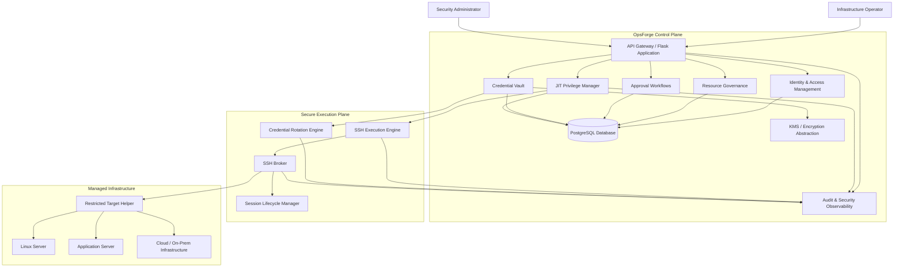
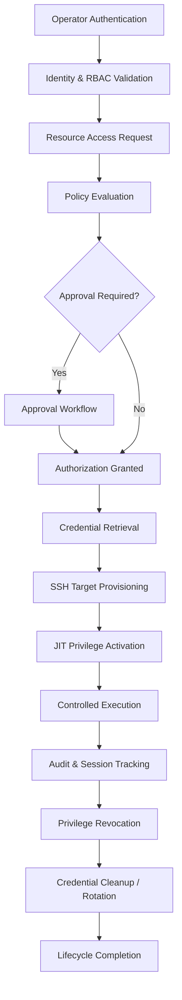

# OpsForge 🛡️
### Unified Privileged Access Management & Secure Infrastructure Automation Platform

<p align="center">
  <strong>Govern Access. Protect Credentials. Control Execution.</strong>
</p>

<p align="center">
  <a href="https://github.com/lokilokith/Devops/actions">
    
  </a>
  
  
  
  
  
  <a href="https://opensource.org/licenses/MIT">
    
  </a>
</p>

---

## 1. Introduction

**OpsForge** is a security-first Privileged Access Management (PAM) and infrastructure automation platform designed to centralize, govern, and secure privileged access across distributed infrastructure environments.

Modern infrastructure operations frequently depend on permanent administrative credentials, fragmented access policies, manually managed SSH keys, and limited visibility into privileged activities. These practices increase the risk of credential compromise, privilege misuse, unauthorized access, and operational inconsistency.

OpsForge addresses these challenges through a unified platform that combines identity governance, policy-driven authorization, encrypted credential management, Just-in-Time (JIT) privilege elevation, secure SSH execution, automated credential rotation, and centralized auditability.

The platform is designed around a fundamental principle:

> **No permanent privilege by default. Every privileged operation should be authorized, controlled, traceable, and revocable.**

OpsForge aims to provide infrastructure and security teams with a centralized control plane for managing privileged access throughout its lifecycle — from identity verification and approval to execution, monitoring, and revocation.

## 2. Vision & Objectives

OpsForge aims to establish a unified security layer between infrastructure operators and managed systems.

### Core Objectives

- Eliminate unnecessary standing administrative privileges.
- Centralize identity, resource, and access governance.
- Enforce granular Role-Based Access Control (RBAC).
- Introduce approval-driven and policy-based authorization.
- Protect infrastructure credentials through encrypted secret management.
- Automate SSH credential provisioning, rotation, and revocation.
- Enable time-bound Just-in-Time privilege elevation.
- Control privileged operations through a secure execution and broker architecture.
- Maintain comprehensive auditability across security-sensitive workflows.
- Improve operational consistency through infrastructure automation.

## 3. Platform Capabilities

OpsForge is designed around interconnected security and infrastructure management capabilities.

### 3.1 Identity & Access Management

Centralized identity and authorization management for infrastructure operators and administrators.

Key capabilities:

- User authentication and identity lifecycle management.
- Role-Based Access Control (RBAC).
- Granular permission and resource authorization.
- Protected API endpoints.
- Access policy enforcement.
- Secure authentication and session handling.
- Administrative access governance.

### 3.2 Resource & Infrastructure Governance

A centralized management layer for infrastructure resources and their associated access policies.

Key capabilities:

- Managed server and infrastructure resource registration.
- Resource ownership and classification.
- Target connectivity configuration.
- Access-policy association.
- Resource-level authorization.
- Infrastructure inventory and lifecycle management.

### 3.3 Approval & Access Request Management

Policy-driven workflows for requesting and authorizing privileged operations.

Key capabilities:

- Infrastructure access requests.
- Approval and rejection workflows.
- Multi-party authorization support.
- Request lifecycle tracking.
- Approval policy enforcement.
- Auditable authorization decisions.
- Controlled access to sensitive operations.

### 3.4 Secure Credential Vault

A centralized credential-management system designed to protect infrastructure secrets throughout their lifecycle.

Key capabilities:

- Envelope-encryption-based secret protection.
- Key Management Service (KMS) abstraction.
- Encrypted credential storage.
- Secret versioning and lifecycle management.
- Compare-and-Swap (CAS) concurrency controls.
- Controlled credential retrieval.
- Credential access authorization.
- Secure secret rotation integration.

### 3.5 SSH Execution & Target Management

A controlled remote execution framework for performing authorized infrastructure operations.

Key capabilities:

- Secure SSH connectivity.
- SSH host-key verification and trusted-host identity management.
- Automated target account provisioning.
- Restricted target-side helper execution.
- Controlled command execution.
- Execution result verification.
- Structured failure classification.
- Secure account lifecycle management.
- Target-side privilege enforcement.

### 3.6 Just-in-Time Privilege Management

A time-bound privilege management system designed to minimize permanent administrative access.

Key capabilities:

- Temporary privilege grants.
- Policy-controlled privilege activation.
- Time-bound access expiration.
- Automated privilege revocation.
- Target-side sudoers policy management.
- Privileged session registration.
- Process-aware session termination.
- Expiration and revocation lifecycle tracking.
- Recovery-oriented handling of failed operations.

### 3.7 Automated Credential Provisioning & Rotation

An automated credential lifecycle management framework for reducing manual SSH credential administration.

Key capabilities:

- SSH key generation and provisioning.
- Managed target credential deployment.
- Credential rotation workflows.
- Credential version management.
- Controlled key replacement.
- Rotation failure handling.
- Lifecycle verification.
- Integration with the credential vault.
- Recovery mechanisms for interrupted rotation operations.

### 3.8 Secure SSH Broker & Session Management

A controlled execution and session coordination layer between authorized application workflows and managed infrastructure.

Key capabilities:

- Broker-mediated SSH operations.
- Controlled execution coordination.
- Session lifecycle management.
- Privilege-aware execution.
- Session isolation.
- Session termination and revocation workflows.
- Secure communication with managed targets.
- Operational traceability.

### 3.9 Audit & Security Observability

Centralized visibility into privileged operations and security-sensitive application activity.

Key capabilities:

- Security-relevant audit records.
- Authentication and authorization activity tracking.
- Privilege activation and revocation records.
- Credential lifecycle event tracking.
- Execution outcome records.
- Structured error and failure reporting.
- Operational monitoring integration.
- Investigation-ready activity history.

## 4. System Architecture

OpsForge follows a modular architecture with clear separation between governance, credential management, execution, and infrastructure-facing components.

### Architectural Planes

| Plane | Responsibility |
|---|---|
| Identity Plane | Authentication, identity lifecycle, RBAC and authorization |
| Governance Plane | Resource management, access requests, approvals and policy enforcement |
| Vault Plane | Encrypted credential storage, retrieval, versioning and rotation |
| Execution Plane | Secure SSH connectivity and remote command execution |
| JIT Privilege Plane | Temporary privilege activation, expiration and revocation |
| Broker Plane | Controlled SSH session and execution coordination |
| Audit Plane | Security event records and operational traceability |

### High-Level Architecture



*This diagram represents the intended logical architecture and major component relationships. Deployment topology and implementation details may evolve.*

## 5. Privileged Access Lifecycle

OpsForge is designed to manage privileged access as a controlled lifecycle rather than a permanent entitlement.



The intended lifecycle includes:

1. Authenticate the operator.
2. Validate identity, roles, and permissions.
3. Request access to an authorized infrastructure resource.
4. Evaluate applicable access policies.
5. Complete required approval workflows.
6. Retrieve authorized credentials through the vault.
7. Establish a trusted SSH connection.
8. Provision or activate the required target access.
9. Apply time-bound JIT privilege.
10. Execute authorized operations.
11. Record security-relevant activity.
12. Revoke temporary privileges and terminate associated sessions.
13. Complete credential cleanup or rotation as required.

## 6. Security Architecture

Security is a foundational design requirement across every OpsForge component.

### Security Principles

**Least Privilege**
- Grant only the permissions required for an authorized operation.
- Minimize permanent administrative access.
- Separate application-level authorization from target-side privilege enforcement.

**Defense in Depth**
- Apply identity, authorization, credential, network, and execution controls.
- Validate remote target identity.
- Restrict target-side helper operations.

**Secure Secret Management**
- Encrypt sensitive credentials.
- Separate encryption and application responsibilities.
- Avoid exposing private keys and master secrets.
- Control credential retrieval and lifecycle operations.

**Fail-Safe Execution**
- Treat uncertain remote execution outcomes explicitly.
- Validate operation results rather than trusting transport success alone.
- Support safe recovery from partial failures.
- Avoid unsafe process termination when process identity cannot be verified.

**Auditability**
- Record security-sensitive actions.
- Preserve meaningful execution outcomes.
- Support investigation and operational accountability.

### Security Validation Strategy

OpsForge incorporates security-focused validation across:

- Authentication and authorization boundaries.
- Credential handling and leakage prevention.
- SSH host-key verification.
- Target-side helper restrictions.
- JIT privilege activation and revocation.
- Credential rotation failure scenarios.
- Session termination and process identity validation.
- Concurrent operations and state consistency.
- Crash recovery and rollback behavior.

Security testing and independent production assurance are ongoing engineering responsibilities, not assumptions made from the presence of security controls.

## 7. Technology Stack

| Category | Technology |
|---|---|
| Programming Language | Python 3.11+ |
| Backend Framework | Flask |
| API Framework | Flask-RESTX |
| ORM | SQLAlchemy |
| Database | PostgreSQL |
| Development / Testing Database | SQLite where configured |
| Authentication | JWT |
| Remote Execution | SSH / Paramiko |
| Encryption | Envelope Encryption / KMS Abstraction |
| Infrastructure | Docker |
| Orchestration | Docker Compose |
| Testing | Pytest |
| Code Formatting | Black |
| Linting | Ruff |
| Security Analysis | Bandit |
| Dependency Analysis | pip-audit |
| CI/CD | GitHub Actions |
| Version Control | Git / GitHub |

## 8. Repository Structure

```text
OpsForge/
│
├── app/
│   ├── api/
│   ├── auth/
│   ├── audit/
│   ├── execution/
│   │   ├── helper/
│   │   └── ...
│   ├── resources/
│   ├── vault/
│   ├── workers/
│   └── ...
│
├── tests/
│   ├── execution/
│   ├── workers/
│   ├── e2e/
│   └── ...
│
├── docker/
│   └── target/
│
├── docs/
├── scripts/
│
├── docker-compose.yml
├── docker-compose.e2e.yml
├── docker-compose.target.yml
├── pyproject.toml
├── requirements.txt
└── README.md
```

The repository structure is modular and may expand as additional platform capabilities are integrated.

## 9. Installation & Development

### Prerequisites

- Python 3.11 or later.
- Git.
- Docker Desktop or Docker Engine.
- Docker Compose.
- PostgreSQL for PostgreSQL-backed environments.
- Authorized SSH test infrastructure for remote execution validation.

### Clone the Repository

```bash
git clone https://github.com/lokilokith/Devops.git
cd Devops
```

### Create a Virtual Environment

**Windows PowerShell**

```powershell
python -m venv .venv
.\.venv\Scripts\Activate.ps1
```

**Linux / macOS**

```bash
python3 -m venv .venv
source .venv/bin/activate
```

### Install Dependencies

```bash
python -m pip install --upgrade pip
pip install -r requirements.txt
```

Install development dependencies using the project's supported configuration.

### Configure Environment

Configure the application using the environment variables and configuration files documented in the repository.

Configuration categories include:

- Application environment.
- Database connectivity.
- Authentication and JWT settings.
- Encryption and KMS configuration.
- CORS and rate-limiting settings.
- SSH execution and broker configuration.
- Target connection and host-key trust configuration.

Never commit production secrets, private SSH keys, encryption keys, or local environment files.

### Start the Application

Use the configured application entry point and environment-specific deployment instructions.

For a configured Flask CLI environment:

```bash
flask run
```

### Docker Environment

Inspect and validate Compose configuration before starting services:

```bash
docker compose config
```

Use the appropriate development Compose configuration for the intended environment. E2E and disposable-target configurations are intended for controlled testing, not direct production deployment.

## 10. Testing & Quality Assurance

OpsForge uses layered testing to validate application behavior, infrastructure interactions, and security-sensitive workflows.

| Test Layer | Validation Scope |
|---|---|
| Unit Testing | Models, services, validators and business logic |
| Integration Testing | Cross-component interactions |
| SSH Integration | Remote connectivity and target operations |
| JIT Testing | Privilege activation, expiration and revocation |
| Rotation Testing | Credential rotation and recovery |
| Security Testing | Authorization, credential handling and trust boundaries |
| Failure Injection | Partial failures and recovery behavior |
| E2E Testing | Complete infrastructure workflows |

### Run Tests

```bash
pytest
```

Execution tests:

```bash
pytest tests/execution/ -v
```

Coverage reporting:

```bash
pytest --cov=app --cov-report=term-missing
```

Security analysis:

```bash
bandit -r app/
```

Dependency auditing:

```bash
pip-audit -r requirements.txt
```

Integration and E2E tests may create or modify disposable infrastructure resources. Review test fixtures, target configuration, and database safeguards before executing them.

## 11. Engineering Roadmap

OpsForge is being developed with a long-term focus on security, reliability, and operational maturity.

| Engineering Area | Long-Term Direction |
|---|---|
| Identity & Governance | Consistent authorization and policy-driven access |
| Credential Vault | Secure secret lifecycle and key-management integration |
| SSH Execution | Reliable remote execution and independent result verification |
| JIT Privileges | Time-bound access with reliable revocation |
| Credential Rotation | Resilient lifecycle automation and recovery |
| Broker Architecture | Secure session isolation and execution coordination |
| Audit & Observability | Centralized activity visibility and operational monitoring |
| Reliability Engineering | Concurrency control, idempotency and crash recovery |
| Deployment | Reproducible installation and environment management |
| Security Assurance | Threat modeling, independent review and penetration testing |

The objective is to evolve OpsForge into a dependable infrastructure security platform with enterprise-oriented operational controls.

## 12. Responsible Use

OpsForge is intended for authorized infrastructure administration, security engineering, and controlled testing.

Users must ensure they have explicit authorization before connecting to, provisioning accounts on, or executing operations against any managed system.

Use isolated disposable infrastructure for development, integration testing, and security validation.

## 13. Contributing

Technical contributions, bug reports, architecture discussions, and security improvement proposals are welcome.

Before submitting changes:

1. Follow existing project conventions.
2. Add tests for new functionality.
3. Validate relevant security boundaries.
4. Document configuration and behavior changes.
5. Avoid committing credentials, private keys, and generated secrets.
6. Provide clear reproduction steps for reported defects.

Please refer to the repository's contribution documentation and GitHub Issues.

## 14. License

Distributed under the MIT License.

See the [LICENSE](LICENSE) file for details.

## 15. Maintainer

**Lokith Duraisamy**

- GitHub: [@lokilokith](https://github.com/lokilokith)
- Repository: [OpsForge](https://github.com/lokilokith/Devops)

---

<p align="center">
  <h3>OpsForge 🛡️</h3>
  <strong>Govern Access. Protect Credentials. Control Execution.</strong>
  <br>
  <sub>Engineering a more secure approach to privileged infrastructure operations.</sub>
</p>
